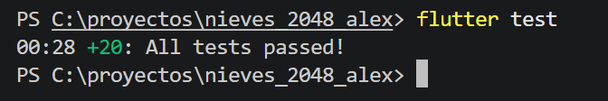
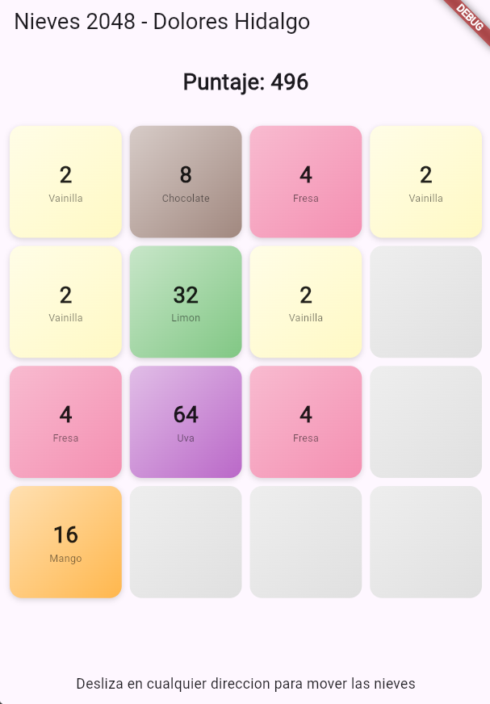

🍦 Nieves 2048 — Evidencia de Proyecto TDD
Desarrollo Móvil Integral | Práctica de Desarrollo Orientado a Pruebas (TDD) en Flutter.

1. Pruebas Unitarias (`flutter test`)

📱 2. Interfaz de Usuario y Animaciones (`flutter run`)

Tablero Principal (Degradados y Sabores) 
 

